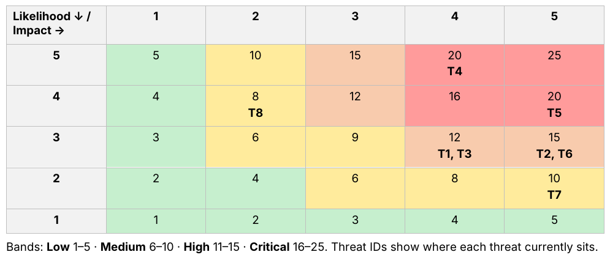
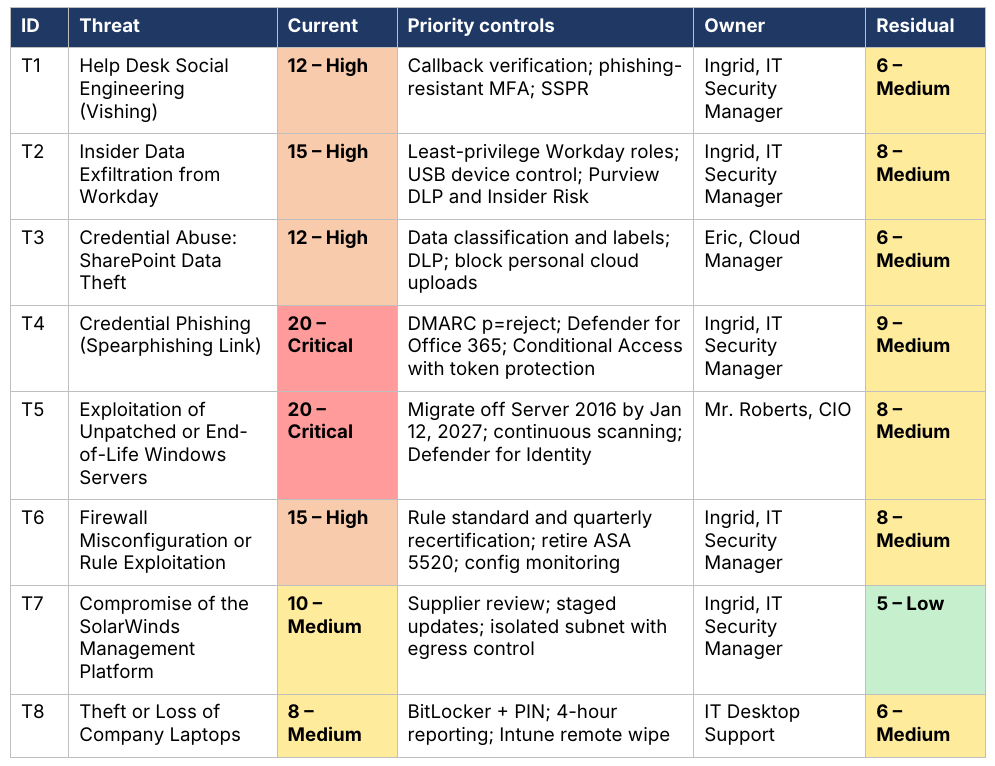
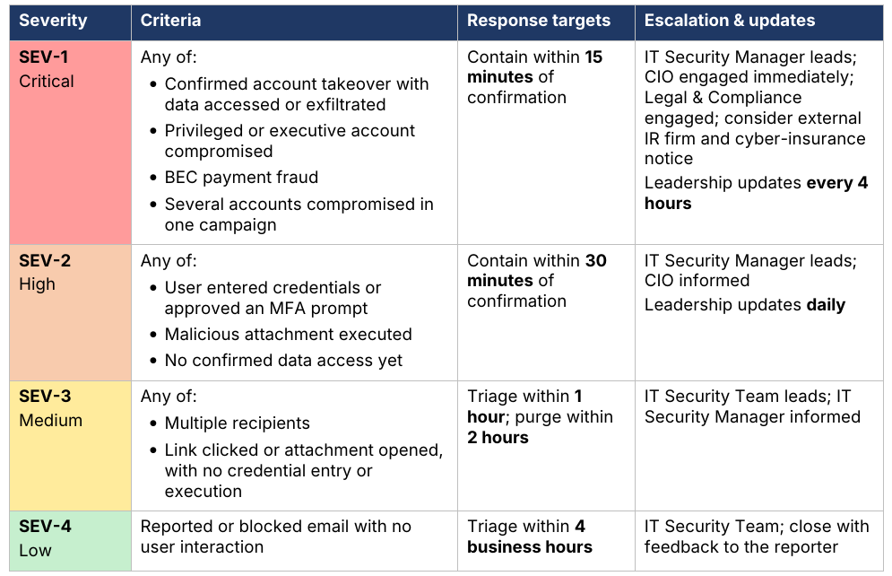

# UGH Cybersecurity Playbooks: Risk Assessment & Phishing Incident Response

Two linked GRC deliverables for **UGH**, a fictional IT services company with 1,900 employees running a hybrid Microsoft 365 E5 and on-premises Active Directory environment:

1. **[Cybersecurity Playbook: Threat, Risk & Control Assessment](UGH-Cybersecurity-Playbook.pdf)** (17 pages): identifies eight threats, scores each one on a 5×5 risk matrix, maps it to MITRE ATT&CK, and recommends controls traced to NIST SP 800-53 and NIST CSF 2.0.
2. **[Phishing Incident Response Playbook](incident-response/UGH-Phishing-IR-Playbook.pdf)** (9 pages): the response plan for the top-rated risk (T4, credential phishing), with severity levels, a RACI matrix, phase-by-phase procedures, notification decisions and metrics.

Together they show the full cycle: **assess the risk → choose controls → plan the response → measure and improve.**

> Built for SM6375 – Cyber Operations Capstone, Master of Security Management (Cybersecurity), University of Houston–Downtown, Spring 2026. Revised for this portfolio in November 2026. UGH is a fictional organization.

---

## Frameworks & Methods

| Area | Framework |
|---|---|
| Structure | NIST Cybersecurity Framework (CSF) 2.0: Govern, Identify, Protect, Detect, Respond, Recover |
| Threat modeling | MITRE ATT&CK Enterprise |
| Control mapping | NIST SP 800-53 Rev. 5 and CSF 2.0 subcategories |
| Risk scoring | 5×5 likelihood × impact matrix, with current and residual risk |
| Incident response | NIST SP 800-61 Rev. 3; Microsoft phishing response playbook |
| Identity assurance | NIST SP 800-63B |

---

## 1. Threat, Risk & Control Assessment

📄 **[Read the full playbook (PDF)](UGH-Cybersecurity-Playbook.pdf)**

| ID | Threat | Current risk | Residual risk |
|---|---|---|---|
| T1 | Help desk social engineering (vishing) | 🟠 High (12) | 🟡 Medium (6) |
| T2 | Insider data exfiltration from Workday | 🟠 High (15) | 🟡 Medium (8) |
| T3 | Credential abuse: SharePoint data theft | 🟠 High (12) | 🟡 Medium (6) |
| T4 | Credential phishing with AiTM session theft | 🔴 Critical (20) | 🟡 Medium (9) |
| T5 | Exploitation of unpatched or end-of-life Windows servers | 🔴 Critical (20) | 🟡 Medium (8) |
| T6 | Firewall misconfiguration or rule exploitation | 🟠 High (15) | 🟡 Medium (8) |
| T7 | Compromise of the SolarWinds management platform | 🟡 Medium (10) | 🟢 Low (5) |
| T8 | Theft or loss of company laptops | 🟡 Medium (8) | 🟡 Medium (6) |

### Key findings

1. **Migrate three Windows Server 2016 systems before January 12, 2027**, when Microsoft extended support ends, or approve a time-bound Extended Security Updates exception.
2. **Enforce phishing-resistant MFA through Conditional Access.** This one control reduces risk across three threats (T1, T3, T4).
3. **Replace security-question verification at the help desk** with callback verification and Temporary Access Passes, in line with NIST SP 800-63B.
4. **Close data exfiltration paths** with USB device control, Purview sensitivity labels and DLP.
5. **Retire an unsupported Cisco ASA 5520** and introduce quarterly firewall rule recertification.

Most of these controls use Microsoft 365 E5 features the company already licenses, so the main investment is configuration and process rather than new tooling.

---

## 2. Phishing Incident Response Playbook

📄 **[Read the IR playbook (PDF)](incident-response/UGH-Phishing-IR-Playbook.pdf)**

Credential phishing (T4) is rated **Critical** in the risk assessment. This playbook makes the response repeatable:

- **Severity model (SEV-1 to SEV-4)** with criteria, response-time targets and escalation paths
- **RACI matrix** covering IT Security, the Cloud team, the Help Desk, Desktop Support, the CIO, and Legal & Compliance
- **Contain-first procedure:** when credentials are entered, sessions are revoked within 30 minutes, before deep analysis begins
- **AiTM and BEC persistence checks:** inbox rules, mail forwarding, rogue MFA methods, OAuth consents
- **Notification decision table** covering breach-notification laws, customers, law enforcement (IC3) and cyber insurance
- **Metrics reported quarterly** (time to triage, time to contain, report rate, click rate) plus an annual tabletop exercise
- **Framework mapping** to CSF 2.0 Respond and Recover subcategories and NIST SP 800-53 IR controls

---

## Skills Demonstrated

- **Risk assessment:** likelihood and impact scoring, inherent vs. residual risk, risk treatment and acceptance
- **Control mapping:** NIST SP 800-53 Rev. 5, NIST CSF 2.0, MITRE ATT&CK
- **Identity & Access Management:** MFA and Conditional Access design, help desk identity proofing, least privilege, access reviews, separation of duties, session revocation
- **Incident response governance:** severity models, RACI, escalation, regulatory notification, post-incident review, KPIs
- **Data protection:** data classification, DLP, insider risk management
- **Vulnerability & third-party risk:** patch SLAs, end-of-life planning, supply-chain risk
- **Microsoft security stack:** Entra ID, Defender XDR, Purview, Intune

## Repository Contents

| File | Description |
|---|---|
| [`UGH-Cybersecurity-Playbook.pdf`](UGH-Cybersecurity-Playbook.pdf) | Threat, risk & control assessment |
| [`incident-response/UGH-Phishing-IR-Playbook.pdf`](incident-response/UGH-Phishing-IR-Playbook.pdf) | Phishing incident response playbook |
| `*.docx` | Editable sources |
| `images/` | Preview images used in this README |

## About Me

**Adeola Oguntuga** · Senior Tax Technology Services Consultant moving into GRC and Identity & Access Management. M.S. Security Management (Cybersecurity), University of Houston–Downtown. 10+ years in IT operations and service desk leadership.

[LinkedIn](https://www.linkedin.com/in/oguntuga/)
